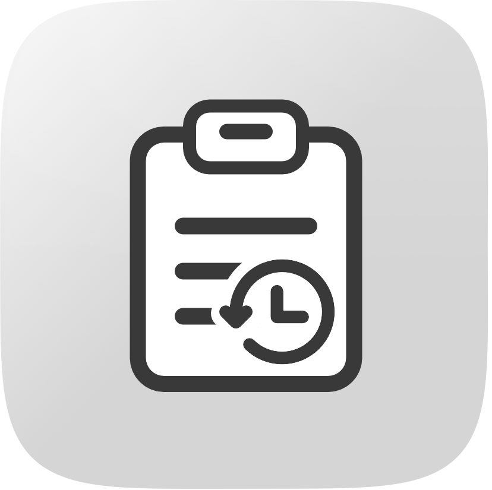

<p align="center">
  
</p>

# CB21

A free, native clipboard history manager for macOS. It lives in the menu bar and remembers what you copy, so you can use anything again without copying it twice.

No account, no ads, no network access, no telemetry.

## Features

- **Remembers everything you copy**: text, rich text, images, files and links.
- **Search** in the menu bar menu and in the History window: just type. It matches text, links, file names and the app a clip came from, ignoring case and accents.
- **Quick select**: ⌘1 to ⌘9 copy one of the first nine clips straight from the menu or the History window.
- **Pin clips** you use often: they stay on top and are never deleted to make room. In the menu, hold ⌥ on a row to pin or unpin it; in the History window use the star.
- **Menu bar list** of your 10 most recent copies. Click one to copy it back.
- **History window** with the full list. Select several clips with Shift or Cmd-click, then delete them. Each row has a Copy button that copies the clip, makes it the most recent and closes the window so you can paste straight away.
- **Global shortcuts** (all optional, you choose the keys): open the History window, open the menu bar list, and pause or resume capture.
- **Details for every clip**: select a clip in the History window to see it in full next to the list. Text shows with character, word and line counts; images with their size and format; PDFs with a first-page preview, page count and title; files with a thumbnail, size, kind and modified date; links with their host. Each row also shows when it was copied, how big it is and which app it came from.
- **Pause capture** for 5 minutes, 15 minutes or until you resume, so you can copy a secret without it being saved.
- **Skips sensitive copies** that apps mark as concealed, such as password managers.
- **You set the limits**: maximum number of clips (default 100) and maximum storage (default 100 MB). The least recently used clips go first.
- **Launch at login**, off by default.
- **A short Welcome** the first time you open CB21: it helps you allow clipboard access, choose whether to start at login, set your shortcuts, and explains what is kept. You can skip any step, and reopen it later from the menu ("Welcome…") or Settings.

## Install

1. Download `CB21-<version>.zip` from the [Releases](../../releases) page and unzip it.
2. Drag `CB21.app` into your Applications folder.
3. Open it. CB21 isn't notarized by Apple, because it is a free project without a paid developer account, so macOS blocks the first launch. Either:
   - open **System Settings > Privacy & Security**, scroll down, and click **Open Anyway** next to CB21; or
   - run `xattr -dr com.apple.quarantine /Applications/CB21.app` in Terminal and open it again.
4. On macOS 15.4 and later, choose **Always Allow** when macOS asks to let CB21 read the clipboard. The Welcome window walks you through it, and you can change it later in **System Settings > Privacy & Security > Paste from Other Apps**. CB21 needs no other permissions: not Accessibility, not Input Monitoring, not Screen Recording.

Requires macOS 14 (Sonoma) or later.

## Build from source

You need Xcode and [XcodeGen](https://github.com/yonaskolb/XcodeGen) (`brew install xcodegen`).

```sh
scripts/check.sh           # runs the tests and builds the app
scripts/build-release.sh   # builds dist/CB21-<version>.zip
```

The app logic lives in the `CB21Core` Swift package (no UI, covered by tests). The `App/` folder holds the menu bar, History window and Settings. The Xcode project is generated from `project.yml` and isn't committed.

## Privacy

CB21 makes no network connections. For each new clip it also remembers the name of the app that was in front when you copied (the "source app"), stored only on your Mac with the rest of your History. History is stored on your Mac in `~/Library/Application Support/cb21/` and **is not encrypted**, so anyone with access to your account can read it. Deleting a clip, or using Clear all, removes it from the database (with SQLite `secure_delete` on) and deletes its image files.

CB21 skips copies that apps mark as concealed or transient. Use Pause for anything else you don't want kept.

## License

CB21 is free software, released under the [GNU General Public License v3.0](LICENSE). You can use it, study it, change it and share it. If you share a modified version, it must stay open source under the same license.

Copyright (C) 2026 Ramy Yasser

This program is free software: you can redistribute it and/or modify it under the terms of the GNU General Public License as published by the Free Software Foundation, either version 3 of the License, or (at your option) any later version. It is distributed in the hope that it will be useful, but WITHOUT ANY WARRANTY, without even the implied warranty of MERCHANTABILITY or FITNESS FOR A PARTICULAR PURPOSE. See the GNU General Public License for more details.

## Project notes

- [`user-stories.md`](user-stories.md): what CB21 does and what is left out of v1.
- [`CONTEXT.md`](CONTEXT.md): the terms used in the code and docs.
- [`docs/adr/`](docs/adr): architecture decisions.
- [`docs/plan.md`](docs/plan.md): the development plan and status.
